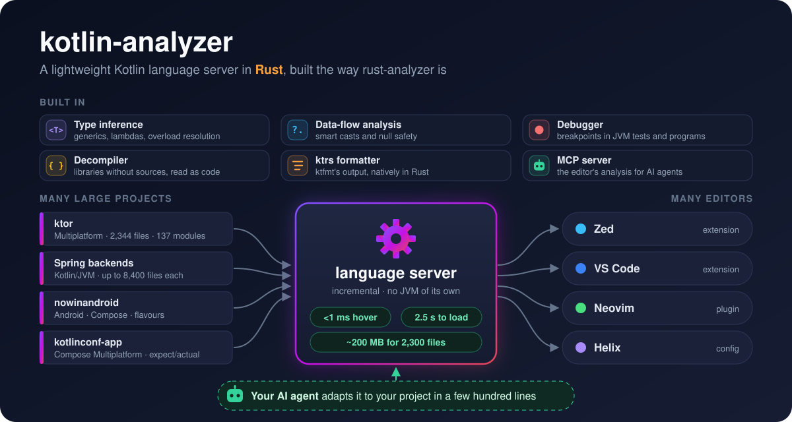

<p align="center">
  
</p>

# kotlin-analyzer

A self-contained, lightweight Kotlin language server (Kotlin LSP) written in
Rust, built the way
[rust-analyzer](https://github.com/rust-lang/rust-analyzer) is, with its own
extensions for VS Code, Neovim, Helix, Zed and Claude Code. It reads Kotlin
JVM, Kotlin Multiplatform and Android projects from their Gradle build, and
Java for navigation and types. It is an alternative to JetBrains'
[kotlin-lsp](https://github.com/Kotlin/kotlin-lsp) and to
[kotlin-language-server](https://github.com/fwcd/kotlin-language-server):
see [Compared with other Kotlin language servers](#compared-with-other-kotlin-language-servers).

**Status: stable.** It is ready for everyday use on the kinds of projects
listed under [Tested on](#tested-on).

- **Low latency:** hover and go-to-definition usually answer in a fraction
  of a millisecond, and diagnostics come back a few milliseconds after an edit
  (see [Benchmarks](#benchmarks)).
- **Low resource use, even on large projects:** no JVM of its own (Gradle runs once, to
  export the build's model) and no background compiler. ktor's 2,300 files load in about 2.5 seconds and stay at about
  200 MB.
- **Made to be customised by AI agents.** No language server can cover every
  combination of SDK, Kotlin and Gradle versions, build scripts and project
  conventions, and no editor extension suits everyone. Instead of trying to,
  this project is laid out so your own AI agent can adapt the server or an
  extension to your project quickly and with few tokens. A missing feature
  usually takes a couple of hundred lines in the right place. The agent's
  starting points are:
  - [`AGENTS.md`](AGENTS.md): the working rules;
  - [`docs/spec/`](docs/spec/): what every feature does, and when it stays
    silent;
  - `editors/*/README.md`: one per editor;
  - `cargo xtask check` with fixture tests, which tell the agent when a
    change is right.

Features:
- go-to definition (into library sources), implementation, hover;
- completion with auto-import, signature help;
- references and rename;
- semantic highlighting, inlay type hints, symbols, folding, expand
  selection;
- code lenses: reference counts, and running a test or a test class with
  Gradle;
- type inference (generics, lambdas, overload resolution) and data-flow
  analysis (smart casts, null safety) behind hover, inlay hints and
  diagnostics;
- diagnostics with quick fixes, which report only what they are sure of;
- formatting by ktrs (ktfmt's output, natively) or ktfmt, which the editor
  extensions download;
- an MCP server for coding agents (`kotlin-analyzer mcp`): definitions,
  references, types, outlines and diagnostics from the editor's own
  analysis, in git worktrees too;
- a debugger for JVM tests and programs (`kotlin-analyzer dap`), in Zed
  and VS Code;
- libraries without sources open decompiled: declarations as Kotlin or
  Java, bodies as Java;
- Gradle tasks in every editor (build, clean, test a module).

### Compared with other Kotlin language servers

| | kotlin-analyzer | [JetBrains kotlin-lsp](https://github.com/Kotlin/kotlin-lsp) | [fwcd kotlin-language-server](https://github.com/fwcd/kotlin-language-server) |
|---|---|---|---|
| Status | stable | alpha | deprecated by its README in favour of kotlin-lsp |
| Runs as | one native binary, no JVM | a JVM application built on IntelliJ IDEA | a JVM application built on the Kotlin compiler |
| Source | open, Apache-2.0 | partly closed source, Apache-2.0 | open, MIT |
| Kotlin Multiplatform | yes (`expect`/`actual`, per source set) | planned | no |
| Android | yes (variants, SDK, `R`) | experimental | no |
| Build systems | Gradle; others by directory layout | Gradle, Maven | Gradle, Maven |
| Editors with its own extension | VS Code, Neovim, Helix, Zed, Claude Code | VS Code; scripts for others | VS Code |
| Diagnostics | only what it is sure of: imports, calls, nullability, `when`, packages | the full compiler's, with IntelliJ's quick fixes | the compiler's |
| Refactorings | rename, formatting (ktrs or ktfmt) | rename, formatting, organize imports | rename |

Choose kotlin-analyzer for large or multiplatform projects, low memory, or
an editor other than VS Code, and when you want to change the server
yourself or with an agent. Choose JetBrains' server for a JVM project where
you want every compiler error, organize imports and more quick fixes.

### Tested on

These are expected to work out of the box:

- **Kotlin/JVM backends:** eight large private Spring Boot monorepos built
  with Gradle, 260 to 8,400 files each, kept at zero false errors.
- **Android:** [nowinandroid](https://github.com/android/nowinandroid)
  (Compose, Hilt, flavours) with AGP 9.3.
- **Kotlin Multiplatform:**
  [kotlinconf-app](https://github.com/JetBrains/kotlinconf-app) (Compose
  Multiplatform) and [ktor](https://github.com/ktorio/ktor) (JVM, JS, Wasm
  and Native targets, `expect`/`actual`).
- **Toolchain:** Gradle 9.x with the Kotlin DSL, Kotlin 2.3–2.5, JDK 21 and 25.
- **Editors:** VS Code 1.146, Neovim 0.12, Helix 25.07 and Zed 1.28, on
  macOS (Apple silicon).

### Not tested

These may need work; your agent can usually add it (see above):

- **Kotlin/JS, Wasm and Native code:** their libraries (klibs) aren't read.
  Such code gets the standard library only, and diagnostics stay silent
  there.
- **Old toolchains:** JDK 8–17, Kotlin 1.x and the K1 compiler, Gradle 7
  and older.
- **Other builds:** Maven, Bazel, Amper and plain `kotlinc`, which get only
  the module layout guessed from the directories. Groovy-DSL Gradle builds,
  `buildSrc` and composite builds are exported but have not been exercised.
- **Other code:** generated sources before the first build (KSP, kapt,
  OpenAPI, protobuf), and Kotlin scripts other than Gradle's.
- **Platforms:** Linux builds are released but haven't been tried in an
  editor. Windows isn't supported.

## How to install

Releases cover macOS and Linux on arm64 and x86_64. The VS Code, Neovim and
Zed extensions download the server on first use. They use `kotlin-analyzer`
from the `PATH` instead, if it is there. To put it there, download the
release into `~/.local/bin`:

```bash
curl -fsSL https://raw.githubusercontent.com/bash-spbu/kotlin-analyzer/main/editors/install-server.sh | sh
```

or build it:

```bash
cargo install --git https://github.com/bash-spbu/kotlin-analyzer kotlin-analyzer
```

Android projects need the SDK, the same as Gradle does: set `ANDROID_HOME`,
or set `sdk.dir` in `local.properties`.

**VS Code**

```bash
curl -LO https://github.com/bash-spbu/kotlin-analyzer/releases/download/v1.1.0/kotlin-analyzer-1.1.0.vsix
code --install-extension kotlin-analyzer-1.1.0.vsix
```

**Neovim** (0.11+, with [lazy.nvim](https://github.com/folke/lazy.nvim))

```lua
{
  "bash-spbu/kotlin-analyzer",
  ft = { "kotlin", "java" },
  config = function(plugin)
    vim.opt.runtimepath:append(plugin.dir .. "/editors/neovim")
    require("kotlin_analyzer").setup()
  end,
}
```

**Helix**: installs the server into `~/.local/bin` and adds it to
`languages.toml`.

```bash
git clone https://github.com/bash-spbu/kotlin-analyzer && kotlin-analyzer/editors/helix/install.sh
```

**Zed**

```bash
git clone https://github.com/bash-spbu/kotlin-analyzer
```

Then run *zed: install dev extension* and pick `kotlin-analyzer/editors/zed`.

**Claude Code**: with the server on the `PATH`, add this repository as a
plugin marketplace and install the plugin:

```bash
claude plugin marketplace add bash-spbu/kotlin-analyzer
```

```bash
claude plugin install kotlin-analyzer@kotlin-analyzer
```

Each editor's settings are in its README under
[`editors/`](editors/).

## Benchmarks

The server was measured on three large open-source Kotlin projects, each
with the model its Gradle build exports (Gradle's own time is not counted):

| | [ktor](https://github.com/ktorio/ktor) `07bb933` | [nowinandroid](https://github.com/android/nowinandroid) `2982e63` | [kotlinconf-app](https://github.com/JetBrains/kotlinconf-app) `146e891` |
|---|---|---|---|
| Kind | Multiplatform library | Android app | Multiplatform app |
| Kotlin files / modules | 2,344 / 137 | 281 / 45 | 260 / 10 |
| Libraries indexed | 386 JARs, 100k names | 399 JARs, 72k names | 317 JARs, 28k names |
| Workspace load (open to ready) | 2.6 s | 1.9 s | 0.5 s |
| Memory after a session | 203 MB | 168 MB | 116 MB |
| Type references resolved | 90.6% | 97.3% | 92.9% |
| Values in bodies with a known type | 97.1% | 97.6% | 96.4% |
| Checking every file (CLI) | 10.3 s, peak 545 MB | 4.1 s, peak 255 MB | 2.2 s, peak 170 MB |
| Open a file → diagnostics, p50 / p95 | 5 / 130 ms | 6 / 91 ms | 5 / 82 ms |
| Edit → fresh diagnostics, p50 / p95 | 2.0 / 20 ms | 1.9 / 6 ms | 2.1 / 13 ms |
| Hover, p50 / p95 | 0.1 / 3.9 ms | 0.1 / 38 ms | 0.1 / 7.0 ms |
| Go to definition, p50 / p95 | 0.1 / 2.3 ms | 0.1 / 19 ms | 0.1 / 4.1 ms |
| Completion, p50 / p95 | 5 / 22 ms | 7 / 23 ms | 5 / 12 ms |

How it was measured:
- Machine: MacBook Pro (Mac16,8), Apple M4 Pro with 12 cores (8
  performance, 4 efficiency), 24 GB RAM, macOS 27.2.1.
- Build: a release build of `kotlin-analyzer` 1.1.0 (Rust 1.99.1), with a
  warm filesystem cache.
- Latencies: over stdio, the way an editor talks to the server. 40 random
  files per project were each opened, then queried for hover and definition
  at 5 random names and for completion after 2 dots, then edited by adding a
  top-level declaration.
- Workspace check: `kotlin-analyzer diagnostics`, its peak the maximum
  resident set size `/usr/bin/time -l` reports.
- Values in bodies: `kotlin-analyzer analysis-stats`, the names in function
  bodies that are values (not classes or argument labels) and whose type
  the inference knows.
- Script: [`bench/lsp_latency.py`](bench/lsp_latency.py), run as
  `python3 -I bench/lsp_latency.py <root> --project-json <model>`.

## Reporting issues

The ideal issue names an **open-source Kotlin project and a file and line**
where the problem shows up, or where the wanted feature would be used. Add:

- what the server did and what you expected;
- the editor;
- the output of `kotlin-analyzer --version`;
- for a project-model problem, the Gradle and Kotlin versions.

A reproducible public project is what lets a fix land quickly, by a person or
an agent. For a private project, a minimal public repository that shows the
same thing works as well.

## License

Apache License 2.0 — see [LICENSE](LICENSE).
